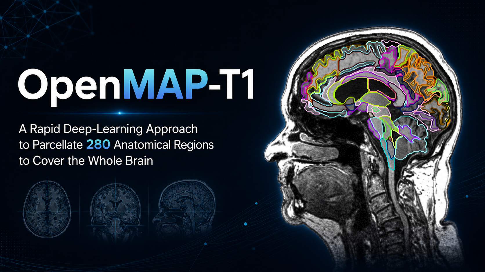
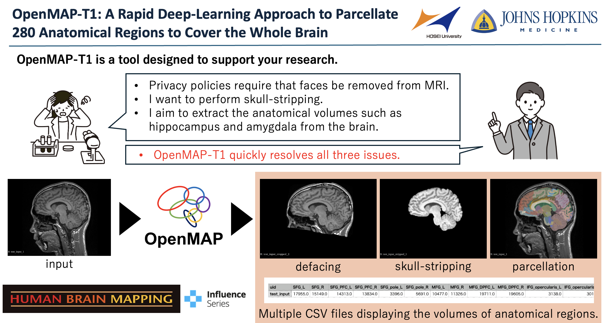
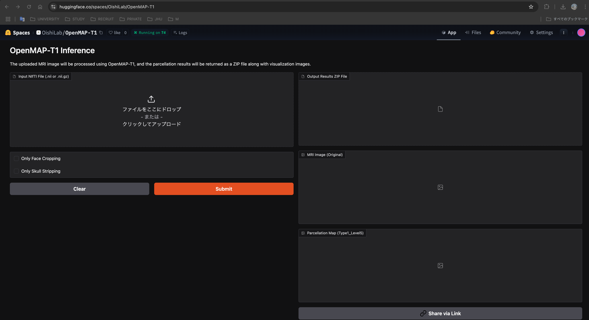
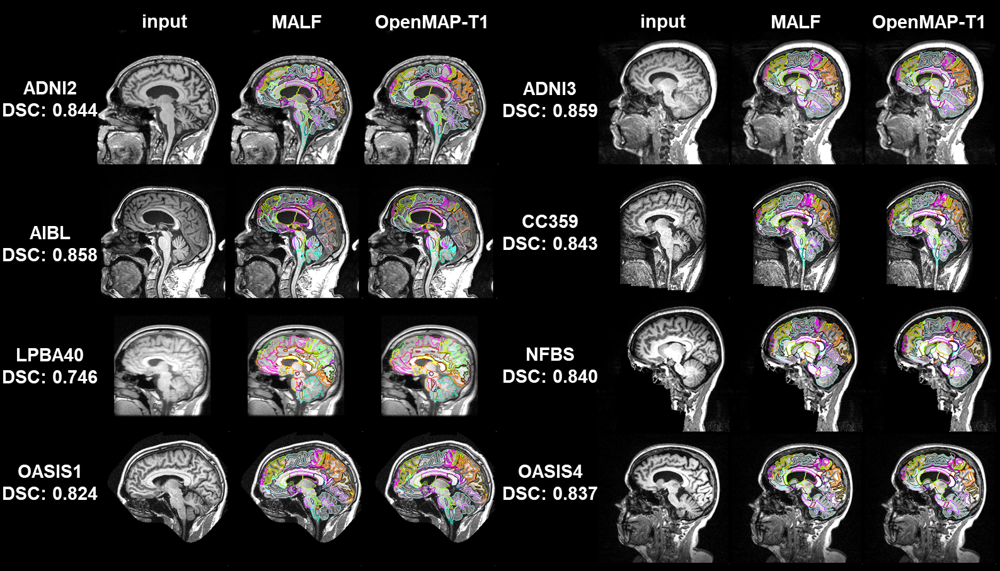
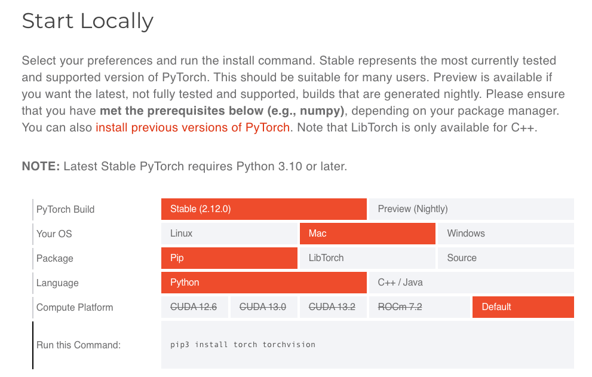
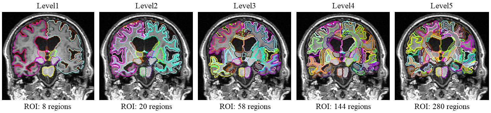
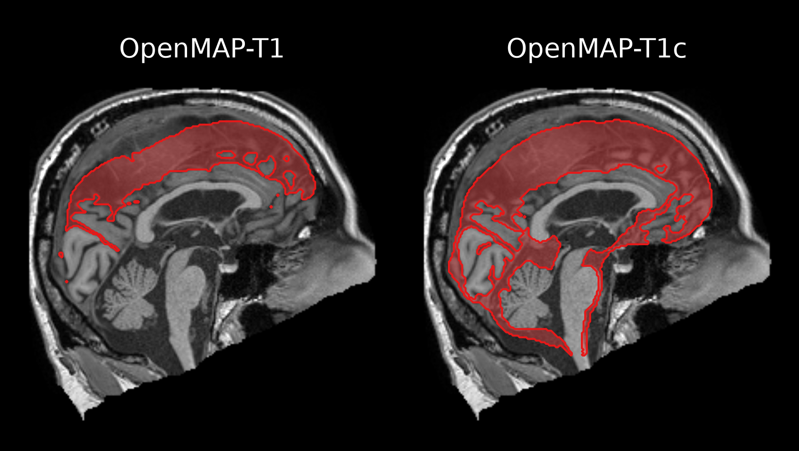

# OpenMAP-T1 and OpenMAP-T1c


**语言**: [English](../README.md) | [日本語 (Japanese)](README-ja.md) | [中文 (Chinese)](README-zh.md)

[](https://www.medrxiv.org/content/10.1101/2024.01.18.24301494v1)
[](https://onlinelibrary.wiley.com/doi/full/10.1002/hbm.70063)
[](https://colab.research.google.com/drive/1fmfkxxZjChExnl5cHITYkNYgTu3MZ7Ql#scrollTo=xwZxyL5ewVNF)

[](https://huggingface.co/spaces/OishiLab/OpenMAP-T1)

[](https://github.com/OishiLab/OpenMAP-T1)

**OpenMAP-T1：一种快速深度学习全脑分区方法，可覆盖 280 个解剖区域**<br>
**作者**: [Kei Nishimaki](https://scholar.google.com/citations?user=iJPjUEkAAAAJ&hl=ja), [Kengo Onda](https://scholar.google.com/citations?user=GEXxaywAAAAJ&hl=en), [Kumpei Ikuta](https://scholar.google.com/citations?user=Q9h-OP8AAAAJ&hl=ja), [Jill Chotiyanonta](https://www.researchgate.net/profile/Jill-Chotiyanonta), [Yuto Uchida](https://scholar.google.com/citations?user=rKPaAF4AAAAJ&hl=ja), [Susumu Mori](https://scholar.google.com/citations?user=eiGSZdMAAAAJ&hl=en), [Hitoshi Iyatomi](https://scholar.google.com/citations?user=ghyQxvIAAAAJ&hl=ja), [Kenichi Oishi](https://www.hopkinsmedicine.org/profiles/details/kenichi-oishi)<br>

The Russell H. Morgan Department of Radiology and Radiological Science, The Johns Hopkins University School of Medicine, Baltimore, MD, USA <br>
Department of Applied Informatics, Graduate School of Science and Engineering, Hosei University, Tokyo, Japan <br>
The Richman Family Precision Medicine Center of Excellence in Alzheimer's Disease, Johns Hopkins University School of Medicine, Baltimore, MD, USA<br>

**摘要**：*本研究介绍了 OpenMAP-T1，这是一种基于深度学习的 T1 加权脑 MRI 快速、准确全脑分区方法，旨在克服传统基于图谱归一化方法和多图谱标签融合（MALF）技术的局限性。脑图像分区是神经科学和临床研究中的基础步骤，可对特定脑区进行详细分析。基于图谱归一化的方法已被用于该任务，但在脑形态存在差异时（尤其是病理状态下）存在局限。MALF 技术提高了分区精度和对形态变化的鲁棒性，但需要大量计算时间。OpenMAP-T1 在六个阶段整合多个卷积神经网络模型：预处理、裁剪、去颅骨、分区、半球分割和最终合并。该流程包括 MRI 标准化、脑组织提取，以及将全脑划分为覆盖灰质和白质细节的 280 个解剖结构，同时简化分区流程并通过鲁棒训练适应多种扫描条件。OpenMAP-T1 在 8 个公开数据集（包括真实临床图像）上进行了验证，在不同扫描仪、磁场强度及去标识化等处理条件下表现出良好鲁棒性。与现有方法相比，OpenMAP-T1 将每张图像的处理时间从数小时缩短到 90 秒以内，且未牺牲精度。该方法对强度不均匀和头部位置变化等临床常见情况尤其有效，显示出作为神经影像通用工具的潜力。*

论文: https://onlinelibrary.wiley.com/doi/full/10.1002/hbm.70063<br>
在线应用: https://huggingface.co/spaces/OishiLab/OpenMAP-T1<br>
已发表于 **Human Brain Mapping**<br>

## OpenMAP 系列
OpenMAP 是将全脑划分为 280 个解剖区域的深度学习模型系列。

- **OpenMAP-T1** 与 **OpenMAP-T1c** 都包含在本仓库中，输入均为 T1 加权 MRI。OpenMAP-T1 侧重于脑实质（尤其是白质）的精细分区。OpenMAP-T1c 使用从 T2 加权 MRI 配准得到的标签进行训练，更加关注脑沟、外侧裂和蛛网膜下腔脑池等 CSF 周边区域。
- 若需根据 T2 加权 MRI 对 CSF 进行更精细的分割，请使用 **[OpenMAP-T2](https://github.com/OishiLab/OpenMAP-T2)**。

## 运行环境
- **Python 3.12 及以上**（scipy 1.18 要求）。Docker 镜像使用仍提供 PyTorch wheel 的最新版本 Python 3.14.8。
- **PyTorch 2.14 及以上**（`uv sync` 会自动安装；使用 pip 时需单独安装）
- 其他固定版本：nibabel 5.4.2、pandas 3.0.6、scipy 1.18.1、SimpleITK 2.5.6、tqdm 4.70.1

# 安装
**OpenMAP-T1 基于 JHU-atlas，可在约 50 秒/例（GPU）内输出全脑 280 区分区结果。**

[](https://colab.research.google.com/drive/1fmfkxxZjChExnl5cHITYkNYgTu3MZ7Ql#scrollTo=xwZxyL5ewVNF)

## 使用 uv 安装（推荐）

[uv](https://github.com/astral-sh/uv) 是用 Rust 编写的高速 Python 依赖管理工具，可作为 pip 的更快替代方案。

0. 安装 uv<br>
   可通过以下方式安装：

   **macOS / Linux:**
   ```bash
   curl -LsSf https://astral.sh/uv/install.sh | sh
   ```

   **Windows:**
   ```powershell
   powershell -c "irm https://astral.sh/uv/install.ps1 | iex"
   ```

   或使用 pip:
   ```bash
   pip install uv
   ```

1. 克隆仓库并进入目录:
```
git clone https://github.com/OishiLab/OpenMAP-T1.git
cd OpenMAP-T1
```

2. 安装依赖（包含 PyTorch）:
```
uv sync
```

3. 通过下方链接申请并下载 **OpenMAP-T1 v3** 预训练模型，放置到服务器上的 `MODEL_FOLDER`。

4. 即可运行 OpenMAP-T1！

## 使用 pip 安装（可选）

0. 请安装 **Python 3.12 及以上** 并创建虚拟环境。<br>

1. 克隆仓库并进入目录:
```
git clone https://github.com/OishiLab/OpenMAP-T1.git
cd OpenMAP-T1
```
2. 安装与你环境匹配的 PyTorch: https://pytorch.org/

最新稳定版 PyTorch（2.14+）需要 **Python 3.10+**；本项目因 scipy 1.18 需要 **Python 3.12+**。

选择环境后，页面会显示相应的安装命令。



如需安装旧版 PyTorch，请访问：<br>
https://pytorch.org/get-started/previous-versions/

3. 安装 PyTorch 以外的依赖:
```
pip install -r requirements.txt
```
4. 通过下方链接申请并下载 **OpenMAP-T1 v3** 预训练模型，放置到 `MODEL_FOLDER`。

5. 即可运行 OpenMAP-T1！

# Docker 安装说明
Docker 镜像基于 `python:3.14.8-slim`，使用从 `uv.lock` 导出的 `requirements_for_docker.txt` 安装依赖。更新依赖后可运行：
```
uv export --no-hashes --no-emit-project --no-dev -o requirements_for_docker.txt
```

1. 构建 Docker 镜像

该命令会根据当前目录中的 `Dockerfile` 及文件创建名为 `openmap-t1` 的镜像。
```bash
docker build -t openmap-t1 .
```
* `docker build`：根据 `Dockerfile` 中的说明构建镜像。
* `-t openmap-t1`：为镜像指定名称标签，便于后续引用。
* `.`：构建上下文为当前目录。

2. 运行 Docker 容器
```bash
docker run --rm -it -v "$(pwd):/app" openmap-t1 -i INPUT_FOLDER -o OUTPUT_FOLDER -m MODEL_FOLDER
```
* `docker run`：从镜像启动新容器。
* `--rm`：容器停止后自动删除，避免残留已停止的容器。
* `-it`：组合选项，`-i` 保持标准输入打开，`-t` 分配伪终端，便于交互。
* `-v "$(pwd):/app"`：将当前目录挂载到容器内的 `/app`，主机与容器可共享文件。
* `openmap-t1`：镜像名称，需先通过 `docker build -t openmap-t1 .` 构建。
* `-i INPUT_FOLDER -o OUTPUT_FOLDER -m MODEL_FOLDER`：传递给应用程序的参数。请将 `INPUT_FOLDER`、`OUTPUT_FOLDER` 和 `MODEL_FOLDER` 替换为挂载目录 `/app` 下存在的路径（例如 `input`、`output`、`model`）。

# 预训练模型下载
可通过以下链接申请下载：
[预训练模型下载链接](https://forms.office.com/Pages/ResponsePage.aspx?id=OPSkn-axO0eAP4b4rt8N7Iz6VabmlEBIhG4j3FiMk75UQUxBMkVPTzlIQTQ1UEZJSFY1NURDNzRERC4u)


# 所有命令
OpenMAP-T1 使用简单。可在 Linux、macOS 或 Windows 的终端中运行，支持 CPU 和 GPU；GPU 速度更快，建议优先使用。以下是最小示例。

## 基本用法
在终端中运行：

```bash
# uv（通过 uv sync 安装时）
uv run python src/parcellation.py -i INPUT_FOLDER -o OUTPUT_FOLDER -m MODEL_FOLDER
```

```bash
# pip（先激活虚拟环境：source .venv/bin/activate）
python3 src/parcellation.py -i INPUT_FOLDER -o OUTPUT_FOLDER -m MODEL_FOLDER
```

```bash
# Docker
docker run --rm -it -v "$(pwd):/app" openmap-t1 -i INPUT_FOLDER -o OUTPUT_FOLDER -m MODEL_FOLDER
```

```bash
# 可选：将输出保存为 .nii（默认输出为 .nii.gz）
python3 src/parcellation.py -i INPUT_FOLDER -o OUTPUT_FOLDER -m MODEL_FOLDER --output-ext .nii
```

* **-i INPUT_FOLDER**：输入脑 MRI 图像所在目录（或单个 `.nii` / `.nii.gz` 文件）。
* **-o OUTPUT_FOLDER**：结果输出目录，不存在时会自动创建。
* **-m MODEL_FOLDER**：包含预训练模型的目录（例如 OpenMAP-T1 使用 `model/V3`，OpenMAP-T1c 使用 `model/OpenMAP-T1c`）。
* **--mode {auto, t1, t1c}**：指定运行的流程类型。默认为 `auto`，会根据 `-m` 中的模型权重（142 类 `PNet` 为 `t1`，139 类 `PNet` 为 `t1c`）自动识别。
* **--output-ext {.nii.gz, .nii}**：输出 NIfTI 扩展名，默认为 `.nii.gz`。
* **--output-space {native, conform, both}**：`cropped/`、`stripped/`、`parcellated/` 中 NIfTI 的体素网格。默认为 `native`。
   * `native`：重采样回 N4 校正后的 canonical 输入网格（默认；文件名与旧版相同）。
   * `conform`：保持 1 mm 等方 256³ 处理网格；文件名带 `_1mm` 后缀。
   * `both`：同时保存两种版本；1 mm 文件保存在 `conform/` 下，文件名带 `_1mm`。
* **--batch-size**：每次前向推理处理的 2.5D 切片数，默认为 `16`。
* **--no-amp**：禁用 CUDA 自动混合精度（AMP），以全精度运行推理。

## 输出空间
推理在内部的 1 mm 等方网格上进行。默认将分区图与中间掩膜重采样回 N4 校正后的 canonical 输入几何（`native`）。若需保持 1 mm 网格或同时保存两种版本，请使用 `--output-space`：

```bash
# uv
uv run python src/parcellation.py -i INPUT_FOLDER -o OUTPUT_FOLDER -m MODEL_FOLDER --output-space conform
uv run python src/parcellation.py -i INPUT_FOLDER -o OUTPUT_FOLDER -m MODEL_FOLDER --output-space both
```

```bash
# pip
python3 src/parcellation.py -i INPUT_FOLDER -o OUTPUT_FOLDER -m MODEL_FOLDER --output-space conform
python3 src/parcellation.py -i INPUT_FOLDER -o OUTPUT_FOLDER -m MODEL_FOLDER --output-space both
```

1 mm 输出的文件名带 `_1mm` 后缀（例如 `A_Type1_Level5_1mm.nii.gz`、`A_cropped_mask_1mm.nii.gz`）。`original/` 文件夹始终按输入几何保存。CSV 区域体积始终在处理用的 1 mm 网格上计算，与此选项无关。

## 可选加速流程
OpenMAP-T1 支持以下互斥标志，仅执行特定步骤以缩短处理时间。

* **仅人脸裁剪**：若只需裁剪并跳过后续步骤：

```bash
# uv
uv run python src/parcellation.py -i INPUT_FOLDER -o OUTPUT_FOLDER -m MODEL_FOLDER --only-face-cropping
```

```bash
# pip
python3 src/parcellation.py -i INPUT_FOLDER -o OUTPUT_FOLDER -m MODEL_FOLDER --only-face-cropping
```

```bash
# Docker
docker run --rm -it -v "$(pwd):/app" openmap-t1 -i INPUT_FOLDER -o OUTPUT_FOLDER -m MODEL_FOLDER --only-face-cropping
```

* **仅去颅骨**：若只需去颅骨并跳过其他步骤。去颅骨以人脸裁剪为前提，裁剪步骤不会被跳过：

```bash
# uv
uv run python src/parcellation.py -i INPUT_FOLDER -o OUTPUT_FOLDER -m MODEL_FOLDER --only-skull-stripping
```

```bash
# pip
python3 src/parcellation.py -i INPUT_FOLDER -o OUTPUT_FOLDER -m MODEL_FOLDER --only-skull-stripping
```

```bash
# Docker
docker run --rm -it -v "$(pwd):/app" openmap-t1 -i INPUT_FOLDER -o OUTPUT_FOLDER -m MODEL_FOLDER --only-skull-stripping
```

## GPU 使用
OpenMAP-T1 在检测到 GPU 时会自动使用 CUDA（启动时显示 `Using device: cuda`）。建议尽可能使用 GPU 运行。单次运行使用一块 GPU。

在 **Linux 或 Windows（WSL2）+ NVIDIA GPU** 上于 Docker 内使用 GPU 前，需先安装 [NVIDIA Container Toolkit](https://docs.nvidia.com/datacenter/cloud-native/container-toolkit/install-guide.html)。若不添加 `--gpus`，即使在 GPU 主机上容器内也常回落为 CPU。

Docker 使用 GPU 的示例：

```bash
docker run --rm -it --gpus all -v "$(pwd):/app" openmap-t1 -i INPUT_FOLDER -o OUTPUT_FOLDER -m MODEL_FOLDER
```

**本地**指定 GPU（例如 GPU 1）时，在命令前添加 `CUDA_VISIBLE_DEVICES=N`：

```bash
# uv
CUDA_VISIBLE_DEVICES=1 uv run python src/parcellation.py -i INPUT_FOLDER -o OUTPUT_FOLDER -m MODEL_FOLDER
```

```bash
# pip
CUDA_VISIBLE_DEVICES=1 python3 src/parcellation.py -i INPUT_FOLDER -o OUTPUT_FOLDER -m MODEL_FOLDER
```

Docker 中也可同样指定（例如主机 GPU 1）：

```bash
docker run --rm -it --gpus '"device=1"' -v "$(pwd):/app" openmap-t1 -i INPUT_FOLDER -o OUTPUT_FOLDER -m MODEL_FOLDER
```

在 **macOS** 上，Docker 运行于 Linux 虚拟机，无法使用主机 Apple Silicon GPU（MPS）。Mac 上若需 MPS 加速请使用原生安装（`uv` 或 `pip`）；Docker 请按 CPU 运行考虑。

Windows 用户若出现错误，请将 `python3` 改为 `python`。

# 文件夹结构
输入图像须为 NIfTI 格式（`.nii` 或 `.nii.gz`）。默认输出为 `.nii.gz`（可用 `--output-ext .nii` 改为 `.nii`）。

下列目录树为 `--output-space native`（重采样回 N4 校正后的 canonical 输入网格）的默认结构。`--output-space conform` 使用相同子文件夹名，但文件保持 1 mm 网格，文件名带 `_1mm`（例如 `A_Type1_Level5_1mm.nii.gz`）。`--output-space both` 在下列 native 结构之外，将 1 mm 版本额外保存于 `conform/`（例如 `conform/parcellated/A_Type1_Level5_1mm.nii.gz`）。
```
INPUT_FOLDER/
   ├ A.nii or .nii.gz
   ├ B.nii or .nii.gz
   ├ *.nii or .nii.gz

OUTPUT_FOLDER/
   ├── processing_log.txt
   ├── failed_cases.csv             # 仅在出现失败、跳过或体积异常偏小病例时生成
   ├── A
   │   ├── cropped
   │   │   ├── A_cropped_mask.nii.gz
   │   │   └── A_cropped.nii.gz
   │   ├── csv
   │   │   ├── A_Type1_Level1.csv
   │   │   ├── A_Type1_Level2.csv
   │   │   ├── A_Type1_Level3.csv
   │   │   ├── A_Type1_Level4.csv
   │   │   ├── A_Type1_Level5.csv
   │   │   ├── A_Type2_Level1.csv
   │   │   ├── A_Type2_Level2.csv
   │   │   ├── A_Type2_Level3.csv
   │   │   ├── A_Type2_Level4.csv
   │   │   ├── A_Type2_Level5.csv
   │   │   └── A_SylvianRatio.csv   # 仅在 OpenMAP-T1c 模式（t1c）下生成
   │   ├── original
   │   │   ├── A_N4.nii.gz
   │   │   └── A.nii.gz
   │   ├── parcellated
   │   │   ├── A_Type1_Level1.nii.gz
   │   │   ├── A_Type1_Level2.nii.gz
   │   │   ├── A_Type1_Level3.nii.gz
   │   │   ├── A_Type1_Level4.nii.gz
   │   │   ├── A_Type1_Level5.nii.gz
   │   │   ├── A_Type2_Level1.nii.gz
   │   │   ├── A_Type2_Level2.nii.gz
   │   │   ├── A_Type2_Level3.nii.gz
   │   │   ├── A_Type2_Level4.nii.gz
   │   │   └── A_Type2_Level5.nii.gz
   │   ├── stripped
   │   │   ├── A_stripped_mask.nii.gz
   │   │   └── A_stripped.nii.gz
   │   └── conform/                 # 仅 --output-space both 时
   │       ├── cropped/
   │       │   ├── A_cropped_mask_1mm.nii.gz
   │       │   └── A_cropped_1mm.nii.gz
   │       ├── parcellated/
   │       │   └── A_Type1_Level5_1mm.nii.gz
   │       └── stripped/
   │           ├── A_stripped_mask_1mm.nii.gz
   │           └── A_stripped_1mm.nii.gz
   ├── ...

MODEL_FOLDER/
   ├ CNet/CNet.pth
   ├ SSNet/SSNet.pth
   ├ PNet/PNet.pth
   └ HNet/HNet.pth
```

预训练模型每个网络使用一个权重文件（OpenMAP-T1 为 `model/V3`，OpenMAP-T1c 为 `model/OpenMAP-T1c`）。`PNet`（以及 OpenMAP-T1c 的 `HNet`）使用单一模型处理所有切面，推理时通过编码切面方向加以区分。

运行时的所有终端输出（标准输出、标准错误及进度日志）都会自动保存在 `OUTPUT_FOLDER` 根目录下的 `processing_log.txt` 中。

若处理失败、被短接标志跳过，或全脑标签体积异常偏小（默认：1 mm 等方网格上 &lt; 10,000 mm³），会记录在 `OUTPUT_FOLDER` 根目录的 `failed_cases.csv` 中。列包括：`case_id`、`input_path`、`status`（`failed`、`skipped` 或 `low_volume`）、`reason`、`total_brain_volume_mm3`。

## Level 元数据（JHU-Atlas）
[`level/`](../level/) 文件夹包含 JHU-atlas 分层定义与映射表，分别整理在 `level/OpenMAP-T1/`（标准 OpenMAP-T1）和 `level/OpenMAP-T1c/`（包含脑沟 CSF 内外分割及蛛网膜下腔脑池的 OpenMAP-T1c）下。

- `level/OpenMAP-T1/OpenMAP-T1_multilevel_lookup_table_dictionary.csv` 与 `level/OpenMAP-T1c/OpenMAP-T1c_multilevel_lookup_table_dictionary.csv` 记录了 **Type1 Level5** 的正式 ROI 名称及其多层级映射关系。
- Type1 文本字典在各自子文件夹下命名为 `Type1Level1.txt` 到 `Type1Level5.txt`。

# 补充信息

OpenMAP-T1 将全脑划分为五级层次结构，最粗级别为 8 个结构，最细级别为 280 个结构。

* 如需进一步可视化和详细分析，可使用 [3D Slicer](https://www.slicer.org/)。3D Slicer 是免费开源的医学图像计算平台，提供分割、配准和 3D 可视化工具，适合探索 OpenMAP-T1 生成的分区图。

* 也可使用 [ROIEditor](https://www.mristudio.org/installation.html)。ROIEditor 是专为医学影像 ROI 创建与编辑设计的免费开源应用，界面友好，便于在 OpenMAP-T1 分区图上分离和分析特定区域。

# 常见问题（FAQ）
* **OpenMAP-T1 的主要贡献是什么？**<br>
使用 GPU 时，OpenMAP-T1 可在约 1–2 分钟内处理一张 T1 加权图像；即使使用 CPU，约 30 分钟即可完成。此外，OpenMAP-T1 对成像环境差异和脑萎缩具有较高鲁棒性。

* **OpenMAP-T1 使用哪个图谱？**<br>
OpenMAP-T1 采用 JHU 图谱。

* **OpenMAP-T1 能否用于 2D 图像？**<br>
论文中未包含，但我们的内部测试表明 2D 图像也可运行。不过部分区域可能会丢失。

* **运行 OpenMAP-T1 需要多少 GPU 显存？**<br>
我们的实验在 24 GB 显存的 NVIDIA RTX3090 上进行。推理所需显存更少，但由于利用 CNN 的全卷积特性，实际需求取决于图像大小。典型图像可在 4 GB 以下显存运行。若出现显存不足，请检查：1）体素间距是否正确；2）MRI 是否仅包含头部区域。

* **OpenMAP-T1 是否支持 MacBook 的 Apple Silicon（MPS）？**<br>
支持。OpenMAP-T1 在 Apple Silicon Mac（M1/M2/M3/M4）上支持 MPS（Metal Performance Shaders）。可用时会自动使用 MPS 加速，比纯 CPU 更快。

* **OpenMAP-T1 和 OpenMAP-T1c 有何区别？**<br>
OpenMAP-T1 旨在对脑实质（尤其是白质结构）进行精细分区；而 OpenMAP-T1c 使用从 T2 加权 MRI 配准得到的标签进行训练，更加侧重于脑脊液（CSF）周边区域（如脑沟、外侧裂及蛛网膜下腔脑池等）的分割。如果您希望对 CSF 进行更加精细和准确的分割（在有 T2 加权图像的情况下），推荐使用 [OpenMAP-T2](https://github.com/OishiLab/OpenMAP-T2)。<br>


* **为什么 OpenMAP-T1 和 OpenMAP-T1c 的部分 CSF 标签并不一致？**<br>
自 [MRICloud](https://mricloud.org/) 时期以来，JHU 图谱一直在持续扩展。OpenMAP-T1 沿用传统定义（V10B）。OpenMAP-T1c 使用的是修订后的图谱，其中部分 CSF 解剖区域已被更新，因此有些 CSF 标签与 OpenMAP-T1 并非一一对应。

* **Type 1 和 Type 2 有何区别？**<br>
Type 1 将脑表面结构分为皮层和皮层下白质，通常用于大多数情况。Type 2 将皮层和皮层下白质作为单一 ROI 输出，适用于希望减少 ROI 数量或使用低分辨率 PET 量化局部脑血流量等参数时。

* **CSV 输出的区域体积单位是什么？为何是整数？**<br>
单位为立方毫米（mm³）。数值为整数，是因为在预处理中将图像 conform 到 1×1×1 mm 各向同性体素后，以各 ROI 的体素数计算体积，每个体素对应 1 mm³。默认将 NIfTI 分区图重采样回 N4 校正后的 canonical 输入几何（`--output-space native`）。若也需要与 CSV 相同 1 mm 网格的 NIfTI，请使用 `--output-space conform` 或 `both`（1 mm 版文件名带 `_1mm`）。

* **`{basename}_SylvianRatio.csv`（例如 `A_SylvianRatio.csv`）是什么？**<br>
该文件在 OpenMAP-T1c 模式（`t1c`）下生成，记录双侧外侧裂（Sylvian fissure）体积与额叶、中央沟及顶叶脑沟 CSF 总体积之比：`(Sylvian Fissure L+R) / (Frontal Sulcus LR + Central Sulcus LR + Parietal Sulcus LR)`。可用于定量评估特发性正常压力脑积水（iNPH）中的蛛网膜下腔不成比例扩大（DESH）等特征。

* **`failed_cases.csv` 记录什么内容？**<br>
批量处理结束时，若有失败、被 `--only-face-cropping` / `--only-skull-stripping` 跳过，或全脑标签体积异常偏小（默认 &lt; 10,000 mm³）的病例，会在 `OUTPUT_FOLDER` 下生成 `failed_cases.csv`。

* **是否提供训练代码？**<br>
不提供。训练代码与无法公开的数据紧密相关。

# 引用
```
@article{nishimaki2024openmap,
  author={Nishimaki, Kei and Onda, Kengo and Ikuta, Kumpei and Chotiyanonta, Jill and Uchida, Yuto and Mori, Susumu and Iyatomi, Hitoshi and Oishi, Kenichi and Alzheimer's Disease Neuroimaging Initiative and {Australian Imaging Biomarkers and Lifestyle Flagship Study of Ageing}},
  title={OpenMAP-T1: A Rapid Deep-Learning Approach to Parcellate 280 Anatomical Regions to Cover the Whole Brain},
  journal={Human Brain Mapping},
  volume={45},
  number={16},
  pages={e70063},
  keywords={brain, deep-learning, MRI, parcellation, segmentation, T1},
  doi={10.1002/hbm.70063},
  url={https://onlinelibrary.wiley.com/doi/abs/10.1002/hbm.70063},
  eprint={https://onlinelibrary.wiley.com/doi/pdf/10.1002/hbm.70063},
  note={e70063 HBM-24-0380.R2},
  abstract={ABSTRACT This study introduces OpenMAP-T1, a deep-learning-based method for rapid and accurate whole-brain parcellation in T1-weighted brain MRI, which aims to overcome the limitations of conventional normalization-to-atlas-based approaches and multi-atlas label-fusion (MALF) techniques. Brain image parcellation is a fundamental process in neuroscientific and clinical research, enabling a detailed analysis of specific cerebral regions. Normalization-to-atlas-based methods have been employed for this task, but they face limitations due to variations in brain morphology, especially in pathological conditions. The MALF techniques improved the accuracy of the image parcellation and robustness to variations in brain morphology, but at the cost of high computational demand that requires a lengthy processing time. OpenMAP-T1 integrates several convolutional neural network models across six phases: preprocessing; cropping; skull-stripping; parcellation; hemisphere segmentation; and final merging. This process involves standardizing MRI images, isolating the brain tissue, and parcellating it into 280 anatomical structures that cover the whole brain, including detailed gray and white matter structures, while simplifying the parcellation processes and incorporating robust training to handle various scan types and conditions. The OpenMAP-T1 was validated on the Johns Hopkins University atlas library and eight available open resources, including real-world clinical images, and the demonstration of robustness across different datasets with variations in scanner types, magnetic field strengths, and image processing techniques, such as defacing. Compared with existing methods, OpenMAP-T1 significantly reduced the processing time per image from several hours to less than 90 s without compromising accuracy. It was particularly effective in handling images with intensity inhomogeneity and varying head positions, conditions commonly seen in clinical settings. The adaptability of OpenMAP-T1 to a wide range of MRI datasets and its robustness to various scan conditions highlight its potential as a versatile tool in neuroimaging.},
  year={2024}
}
```

# 相关研究
以下研究在 T1 加权 MRI 的高级分割与分析中使用了 OpenMAP-T1。
* **[Data-driven schizophrenia subtyping via brain atrophy trajectories and functional connectivity](https://www.nature.com/articles/s41398-026-03968-w)**  
   *作者:* Daisuke Yoshimaru, Kazuya Ouchi, Shuhei Shibukawa, Masakazu Ozawa, Motoki Hirabayashi, Ami Yuzawa, Tomokazu Tsurugizawa, Kenichi Oishi, Hirotaka James Okano;  
   *期刊:* Translational Psychiatry
* **[Change points for dynamic biomarkers in the Alzheimer's disease pathological cascade: A 30-year cohort study](https://alz-journals.onlinelibrary.wiley.com/doi/full/10.1002/alz.70544)**  
   *作者:* Yuto Uchida, Kei Nishimaki, Anja Soldan, Corinne Pettigrew, Sara Grace Ho, Abhay Moghekar, Mei-Cheng Wang, Michael I. Miller, Marilyn Albert, Kenichi Oishi;
   *期刊:* Alzheimer's & dementia
* **[Acceleration of Brain Atrophy and Progression From Normal Cognition to Mild Cognitive Impairment](https://jamanetwork.com/journals/jamanetworkopen/fullarticle/2825474)**  
   *作者:* Yuto Uchida, MD, PhD; Kei Nishimaki; Anja Soldan, PhD; Abhay Moghekar, MBBS; Marilyn Albert, PhD; Kenichi Oishi, MD, PhD;  
   *期刊:* JAMA Network Open
* **[A Neural Network Approach to Identify Left–Right Orientation of Anatomical Brain MRI](https://pmc.ncbi.nlm.nih.gov/articles/PMC11808181/)**  
   *作者:* Kei Nishimaki; Hitoshi Iyatomi, PhD; Kenichi Oishi, MD, PhD;  
   *期刊:* Brain and Behavior
